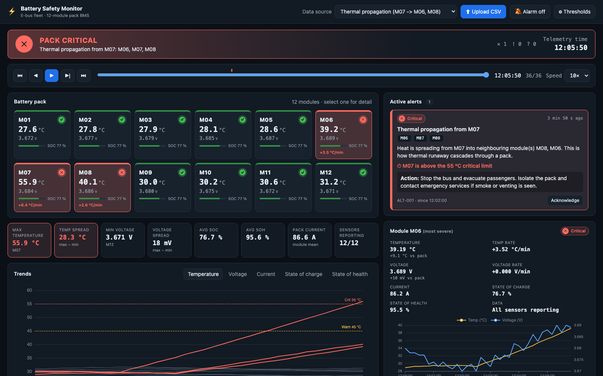

# Battery Safety Monitor: UAEC 2026

An interactive battery-management dashboard for an electric-bus fleet operator.
It replays battery telemetry as a live feed, shows the health of every module in a 12-module pack,
raises graded alerts, and tells the operator **what is wrong, where, how soon it becomes critical, and what to do**.

Built for the University of Alberta Engineering Competition 2026, Programming category.



## Quick start

Requires **Node.js 18+** (tested on Node 22).

```bash
npm install
npm run dev        # open http://localhost:5173
```

Then either pick a scenario from **Data source**, or **drag any CSV onto the page** (or use **Upload CSV**).
Playback starts automatically. Space = play/pause, ← / → = step.

| Command | What it does |
|---|---|
| `npm run dev` | Start the dashboard with hot reload |
| `npm test` | Run the 50 detection-engine tests |
| `npm run build` | Type-check and build a static site into `dist/` |
| `npm run preview` | Serve the production build at http://localhost:4173 |
| `npm run lint` | ESLint |

Deep links open a scenario at a given moment, e.g. `http://localhost:5173/?scenario=thermal_rise&frame=27`
(`frame=end` jumps to the last sample).

## Features

### Situational awareness
- **Pack status banner:** one glance answers "is anything wrong?" (Normal / Sensor fault / Warning / Critical), with the top problem and the telemetry clock.
- **Pack map:** 12 module tiles in series order (adjacent modules sit side by side), each with temperature, voltage, SOC, severity and the reason for it.
- **Alert cards:** title, affected modules, diagnosis, **time-to-limit forecast** ("M07 reaches 55 °C in ~44 s"), recommended **action**, and acknowledge.
- **KPI bar:** max temperature, temperature spread, min voltage, voltage spread, average SOC/SOH, pack current, sensors reporting. Each KPI turns amber/red at the same limits the engine uses.

### Fault detection & diagnosis
- Three detectors per module: **absolute safety limits**, **deviation from the pack median** and **rate of change**.
- **Persistence and hysteresis** filter: a condition must persist before it alerts and recover with margin before it clears, so normal data raises **zero** alerts.
- **Diagnosis rules** turn conditions into root causes: isolated thermal event, multi-module (cooling) heating, **thermal propagation from a source module**, pack-wide heating, **internal short** (heating + voltage drop), module voltage drop, over-voltage, low SOC, degraded SOH, abnormal current.
- Alerts keep one identity as a problem grows, escalates or eases (no alert floods).

### Data integrity
- **Sensor faults are not battery faults.** Missing, stuck, out-of-range, sentinel (`-999`), corrupted (`ERR`, `abc`) and spiking readings are reported as *data faults* in purple with a hatched tile, and are excluded from hazard detection and from the pack median.
- A module that loses its sensor while overheating **keeps its thermal alert** (unknown is not safe).
- Pack-wide dropouts are diagnosed as one **communication loss**, not twelve separate alerts.
- Robust CSV ingestion: header variations, reordered or extra columns, blank or `NaN` cells, unreadable, duplicate or out-of-order timestamps, missing or extra modules, any module count, any sample interval, module-level or cell-level voltage (cells in series is inferred automatically). A **data-quality panel** reports everything that was wrong with the file.

### Historical analysis
- **Trend charts** for temperature, voltage, current, SOC and SOH with warning/critical lines. Healthy modules are drawn grey, troubled modules in their severity colour, and the selected module in blue.
- **Module detail:** every reading, deviation from the pack, rates, a temperature/voltage chart and the active conditions.
- **Event log** of every raise, escalation, clearance and ignored blip, **exportable to CSV**.
- **Playback:** play, pause, step, scrub, 1–50× speed, with alert markers on the timeline.

### Operator controls
- **Thresholds panel:** every key limit is editable and the whole file is re-analysed instantly.
- Optional **audible alarm** for new critical alerts.
- Accessible: colour is always paired with an icon and a word, keyboard operable, `prefers-reduced-motion` respected.

## How it works

```
CSV ─▶ parser ─▶ sensor integrity ─▶ hazard detectors ─▶ persistence / hysteresis ─▶ diagnosis ─▶ alert lifecycle ─▶ UI
        │              │                (absolute,            (ConditionTracker)          (rules)       (AlertManager)
        ▼              ▼                 pack-relative,
  data-quality    data faults            rate of change)
     report
```

The engine (`src/core`) is plain TypeScript with no UI code. It processes the file frame by frame and is
**causal**: the state at time *t* depends only on data up to *t*, so replaying a file is identical to
monitoring it live. The UI (`src/ui`) only renders the engine's output.

| Layer | File | Responsibility |
|---|---|---|
| Types | `src/core/types.ts` | Shared data contract between engine and UI |
| Config | `src/core/config.ts` | Every threshold, each with its justification |
| Parser | `src/core/parser.ts` | Tolerant CSV ingestion and the data-quality report |
| Sensor integrity | `src/core/detectors/sensorIntegrity.ts` | Missing, stuck, out-of-range, spike, status checks |
| Hazards | `src/core/detectors/hazards.ts` | Absolute, pack-relative and rate-of-change checks |
| False-alarm filter | `src/core/conditions.ts` | Persistence, hysteresis, freeze-on-dropout |
| Diagnosis | `src/core/diagnosis.ts` | Grouping, root-cause rules, actions, forecasts |
| Alerts | `src/core/alerts.ts` | Alert identity, escalation, merging, clearing |
| Engine | `src/core/engine.ts` | Runs the pipeline over every frame |
| UI | `src/ui/`, `src/App.tsx` | Components, state store, playback |

### Key thresholds

Full justification: **[docs/DETECTION_LOGIC.md](docs/DETECTION_LOGIC.md)**. Relative and rate thresholds are set at
about 2× the worst case measured in the normal dataset ([docs/DATA_ANALYSIS.md](docs/DATA_ANALYSIS.md)).

| Check | Warning | Critical | Normal-data worst case |
|---|---|---|---|
| Temperature | ≥ 45 °C | ≥ 55 °C | 31.7 °C |
| Temperature above pack median | > 5 °C | > 10 °C | 2.3 °C |
| Temperature rise rate | > 2 °C/min | > 4 °C/min | 0.86 °C/min |
| Cell voltage low / high | ≤ 3.40 / ≥ 4.15 V | ≤ 3.20 / ≥ 4.20 V | 3.669–3.691 V |
| Voltage from pack median | > 30 mV | > 100 mV | 13 mV |
| Voltage drop rate | > 0.05 V/min | > 0.10 V/min | 0.016 V/min |
| SOC / SOH | ≤ 20 % / ≤ 80 % | ≤ 10 % / ≤ 70 % | 76.6 % / 95.2 % |
| Persistence to raise | 3 samples | 2 samples | |

### Results on the test scenarios

| Scenario | Result |
|---|---|
| Normal operations | No alerts |
| Low voltage (M03) | Module voltage drop, critical, 20 s after onset (3.2 V crossed only 3 min later) |
| Thermal rise (M07) | Isolated thermal event, critical, 20 s after onset at 30.6 °C, with time-to-55 °C forecast |
| Multiple module heating | One "Multi-module heating (M04–M06)" alert, critical, no other modules involved |
| Sensor failure | M11 sensor dropout (data fault) that clears on recovery; single-sample dropouts logged only |
| 12 generated scenarios | Over-voltage, internal short, thermal propagation, pack-wide heating, low SOC, stuck sensor, spike (ignored), comms loss, missing module, heating with dropout, corrupted values, messy format: all diagnosed correctly, no false alarms |

All of these are enforced by the test suite (`npm test`).

## Input format

One row per module per timestamp:

```
Timestamp,Module ID,Temperature (C),Voltage (V),Current (A),State of charge (%),State of Health (%),Sensor Status
2026-01-01 12:00:00,M01,27.57,3.685,85.61,78.07,95.8,OK
```

Column names are matched loosely (case, spacing, units and order do not matter), and only `Timestamp` and `Module ID` are required.
Module IDs, module count and sample interval are read from the file, never hard-coded.

## Repository layout

```
src/core/          Detection engine (pure TypeScript, no UI)
src/ui/            React components, state store, charts
src/App.tsx        Dashboard layout
tests/             Vitest suite: provided datasets, generated scenarios, parser edge cases
public/scenarios/  Built-in scenarios (5 provided + 12 generated) and index.json manifest
tools/             Python: scenario generator, reference detector and validator
data/              Original competition datasets
docs/              Detection logic, data analysis, project plan, figures, presentation
documentation/     Official competition brief and rubric
```

### Python tools

```bash
python3 tools/generate_scenarios.py          # regenerate the 12 synthetic scenarios (+ --plot for figures)
python3 tools/detect.py public/scenarios/thermal_rise.csv   # independent Python reference detector
python3 tools/validate.py                    # check the Python detector against every scenario
```

The Python reference detector is an independent implementation of the same rules, used to cross-check the
TypeScript engine.

## Tech stack

React 19, TypeScript, Vite, ECharts, Zustand, PapaParse, Vitest. The app runs entirely in the browser: no server,
no data leaves the machine.

## Team

UAEC 2026 Programming. See commit history for contributions.
